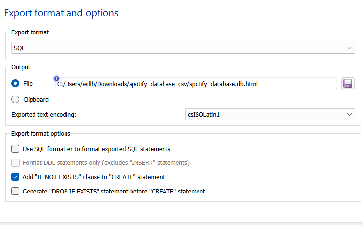

# Spotify Music Database & Analytics

### SQL | SQLite | SQLiteStudio | Database Design | Data Analytics

## Project Overview

Developed a relational SQL database to organize and analyze over **1.2 million Spotify song records**, focusing on database design, efficient data retrieval, and music analytics.

The project uses SQL queries, relational tables, analytical views, and database indexes to examine relationships between artists, albums, songs, and musical characteristics.

## Dataset

**Source:** [Spotify 1.2M+ Songs Dataset – Kaggle](https://www.kaggle.com/datasets/rodolfofigueroa/spotify-12m-songs/data)

The database contains:

- **1,204,025** song records
- **166,424** artists
- **118,383** albums

The original dataset was imported into SQLiteStudio and organized into a relational database.

## Technologies Used

- **SQL (SQLite):** Database creation, data retrieval, and analysis
- **SQLiteStudio:** Database management and SQL execution
- **Relational Database Design:** Primary keys, foreign keys, and table relationships
- **Database Indexing:** Supporting efficient data retrieval

## Database Design

The database consists of five primary relational tables and an additional raw-data staging table.

| Table | Description |
|---|---|
| Artist | Stores unique artist identifiers and names |
| Album | Stores album information and artist relationships |
| Song | Stores individual song records and associated metadata |
| Track_Feature | Stores audio characteristics, including energy, danceability, and tempo |
| Release_Info | Stores album release dates and years |
| RawTracks | Contains the original imported Spotify data |

The database uses primary and foreign keys to establish relationships between entities.

### Entity Relationship Diagram

## SQL Analysis

Developed **12 analytical SQL queries** to investigate patterns across the Spotify dataset.

The analyses include:

1. Songs belonging to the top 100 artists by track count
2. Total number of songs associated with each artist
3. Song counts across albums
4. Total album durations
5. Average danceability and valence by release year
6. Albums with the highest average energy
7. Artists with the highest average danceability
8. High-energy songs across release years
9. Average tempo by artist
10. Songs with high energy and low acousticness
11. Artists represented across the greatest number of albums
12. Variation in song energy across artists

### SQL Techniques Demonstrated

- Multi-table JOINs
- Subqueries
- Aggregate functions: COUNT, SUM, AVG, MIN, MAX
- GROUP BY and HAVING
- Conditional filtering with WHERE
- Sorting with ORDER BY

**SQL Queries:** [View All 12 Queries](spotify_analysis_queries.sql)

## Analytical Views

Created three SQL views to simplify complex data retrieval and support different types of music analysis.

| View | Purpose |
|---|---|
| Listener_Song_Browse | Combines song, artist, album, duration, and release information |
| Album_Summary | Aggregates song counts, album duration, and average audio characteristics |
| Music_Analysis | Organizes audio features for comparing songs and artists |

## Database Optimization

Implemented database indexes to support more efficient searching, joining, and retrieval.

Indexes were created on frequently referenced columns, including song and artist identifiers, album identifiers, and release years.

These indexes support queries involving multiple interconnected tables.

## Project Files

| File | Description |
|---|---|
| [Database Schema](spotify_database_schema.sql) | Table definitions, relationships, views, and indexes |
| [SQL Analysis Queries](spotify_analysis_queries.sql) | 12 documented SQL queries |
| [Project Report](spotify_database_report.pdf) | Complete project documentation and query results |
| [ER Diagram](er_diagram.png) | Visual representation of database relationships |

## Reproducing the Project

1. Install SQLite or SQLiteStudio.
2. Download the original dataset from Kaggle.
3. Run `spotify_database_schema.sql` to create the database structure.
4. Import and populate the relational tables using the dataset.
5. Run `spotify_analysis_queries.sql` to perform the analyses.

**Note:** The SQL schema creates the database structure, but data import and transformation scripts are not included. The original populated database is approximately 0.98 GB and is not hosted in this repository.

## Project Contributors

This database was developed as a collaborative academic project at the New Jersey Institute of Technology (NJIT).

**Contributors:** William Bruseo, Jianna Fernandez, Jeremy Batista, and Alvin Lai.
